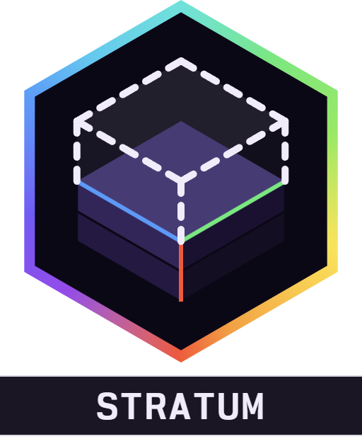

<div align="center">



# Alaydriem's Stratum

[](https://github.com/alaydriem/amml-stratum/releases)
[](https://github.com/alaydriem/amml-stratum/actions/workflows/build.yml)
[](./LICENSE)

[](https://github.com/alaydriem/amml)

</div>

A structure helper for Minecraft Bedrock. Import `.mcstructure` files, place a marker in the world, and build over the ghost blocks layer by layer, with a material list for the full build, fully client side as an AMML mod, written in Rust for high performance using Bedrock's native rendering engine.

Stratum does the job of Structura and Holoprint, without the limits of Bedrock's scripting engine. It runs as an AMML mod and reads and draws through the game itself.

## Features

- Projects with structure libraries
- Import a .mcstructure while in the game from the Windows native file picker. No more converting structures to Structura or Holoprint.
- Persistent markers that are locked to their position and settings in each world. Create markers for all of your projects, load them when you need them, and pick up _exactly_ where you left them. No more re-adjusting Holoprint or Structura packs to get them locked to the right position.
- Rotate, move, and adjust the opacity and layer for each structure independently, with ghost blocks for the active marker
- Easy Place - grab your items in your inventory then right click to auto-place the correct block from your inventory. Slabs and stairs take their top or bottom half from the structure; the facing follows the player
- Material lists with text export, item counts, and stacks with sorting and filtering
- In game rendering previews of every structure

## Installation

Install it with the [AMML launcher](https://github.com/alaydriem/amml/releases/latest). The launcher also installs the AMML loader and Alaydriem's Mod Manager, which this mod needs.

## Usage

1. Press <kbd>F3</kbd> + <kbd>S</kbd> to open the library.
2. Import a `.mcstructure` file, or drop files into `mods/amml/@alaydriem/stratum/data/import`. New files go to
   Unsorted.
3. Select a structure or a project and click **Place marker here**. The marker is placed at your feet and becomes the active marker.
4. Close the library. Use the HUD keys to move through the layers and adjust the marker.

## Controls

| Key | Action |
| --- | --- |
| <kbd>F3</kbd> + <kbd>S</kbd> | Open / close the library |
| <kbd>F10</kbd> | Change the HUD between Quick and All controls |

The HUD keys work while no screen is open and a marker is active.

### Quick mode

| Key | Action |
| --- | --- |
| <kbd>↑</kbd> / <kbd>↓</kbd> | Layer up / down |
| <kbd>←</kbd> | Show / hide the ghost |
| <kbd>→</kbd> | Change the opacity |

### All controls mode

<kbd>←</kbd> and <kbd>→</kbd> select a control. <kbd>↑</kbd> and <kbd>↓</kbd> change it.

| Control | Action |
| --- | --- |
| Layer | Layer up / down |
| Opacity | Opacity up / down |
| Show | Show / hide the ghost |
| Structure | Next / previous structure (only when the marker shows a project) |
| Move X / Y / Z | Move the marker one block along the axis |
| Rotate | Rotate the marker |
| Easy Place | Easy Place on / off |

All keys can be changed on the mod manager's Keybinds page.

## Configuration

Settings are in the mod manager panel and saved to `config.hcl` in the mod's config folder.

<details>
<summary>All settings</summary>

| Section | Setting | Default | Description |
| --- | --- | --- | --- |
| `keys` | `open_library` | `"F3+S"` | Open / close the library |
| | `hud_up` / `hud_down` | `"Up"` / `"Down"` | HUD up / down |
| | `hud_left` / `hud_right` | `"Left"` / `"Right"` | HUD left / right |
| | `hud_mode` | `"F10"` | Change the HUD mode |
| `library` | `max_structures` | `4096` | Most structures (`16`–`65536`). Imports past this are refused |
| | `max_projects` | `512` | Most projects (`1`–`4096`) |
| `markers` | `max_per_world` | `256` | Most markers per world (`1`–`4096`) |
| `import` | `max_file_mb` | `256` | Largest structure file in MB (`1`–`256`) |
| | `inbox_poll_seconds` | `2.0` | Time between checks of the import folder (`0.5`–`30.0`) |
| `cache` | `budget_mb` | `128` | Memory for structures read for material lists (`64`–`2048`) |
| `preview` | `texture_cache` | `1024` | Block textures the 3D preview keeps decoded (`16`–`8192`) |
| | `max_quads` | `1000000` | Most block faces one 3D preview draws (`10000`–`4000000`); a bigger structure is cut |
| `ghost` | `miniature` | `true` | Show the full build in miniature at its lowest corner; off shows a structure block there |
| | `draw_distance` | `0` | Draw distance in chunks (`0`–`64`); `0` uses the game's render distance |
| | `mesh_budget_mb` | `1024` | Graphics memory the ghost blocks can use (`64`–`8192`) |
| | `cells_per_frame` | `600` | Cells built per frame (`64`–`2000`); higher builds faster and costs more frame time |
| `debug` | `telemetry` | `false` | Log tick and frame cost, thread wake-ups and saves every 2 s |

The `library`, `markers`, `import`, `cache` and `ghost.mesh_budget_mb` settings apply after a restart.

</details>

## FAQ

**Can I use it on servers?** Yes, but check the server rules first. Ghost blocks are drawn on your screen only. Easy Place places blocks when you right click, and moves items in your inventory. Turn Easy Place off in the All controls HUD if the server does not allow it.

**Which file types can I import?** `.mcstructure` only, as saved by a structure block or a structure export tool.

**Why are some parts of a big build missing?** The ghost memory budget is full. Raise `ghost.mesh_budget_mb` or lower `ghost.draw_distance`.

## Building

Requires Windows x64, [mise](https://mise.jdx.dev), rustup and [cargo-nextest](https://nexte.st). Cargo fetches `amml` and `amml-modmanager` from GitHub at tag `26.60.5`. No sibling checkout is needed.

```powershell
mise trust
mise run preflight
mise run package
mise run test
```

`mise run package` writes `dist/@alaydriem/stratum`.

## License

BSD 3-Clause. Copyright (c) 2026 Charles R. Portwood II. See [LICENSE](./LICENSE). [Nordwand Mono](https://github.com/tywr/Nordwand-Mono) is under the SIL Open Font License 1.1.
